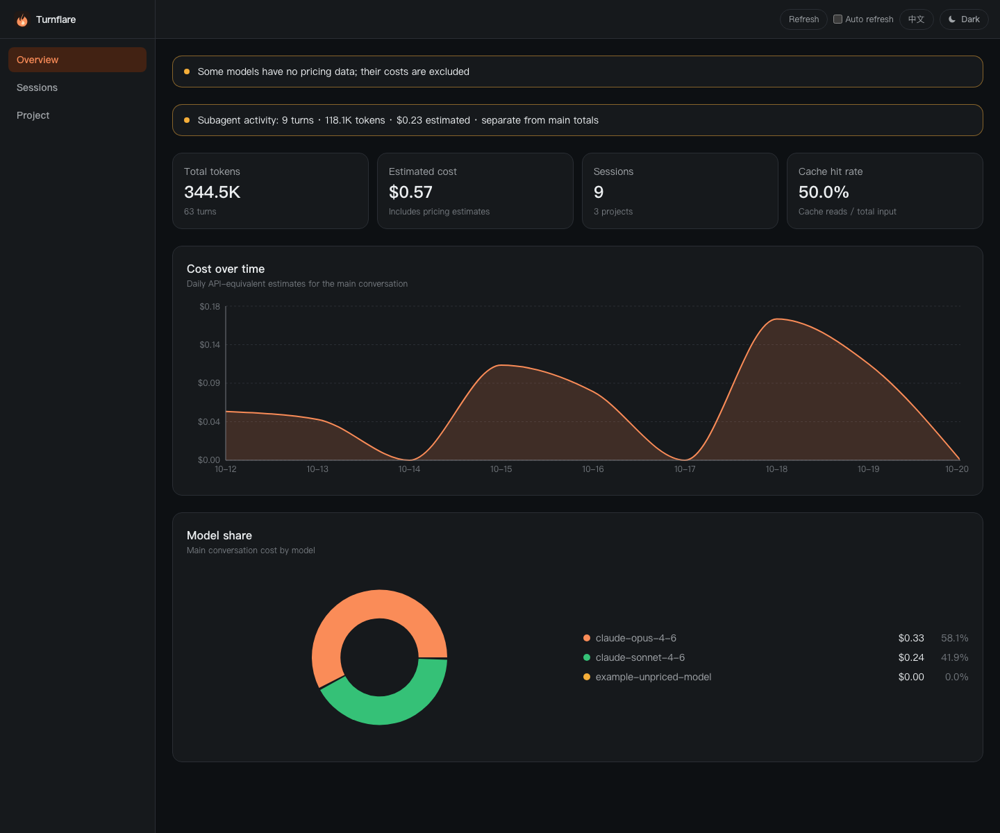
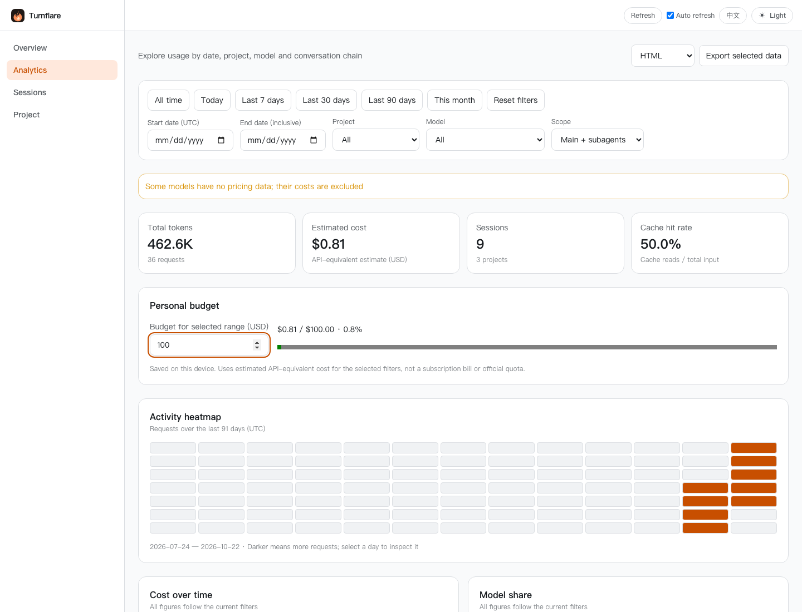
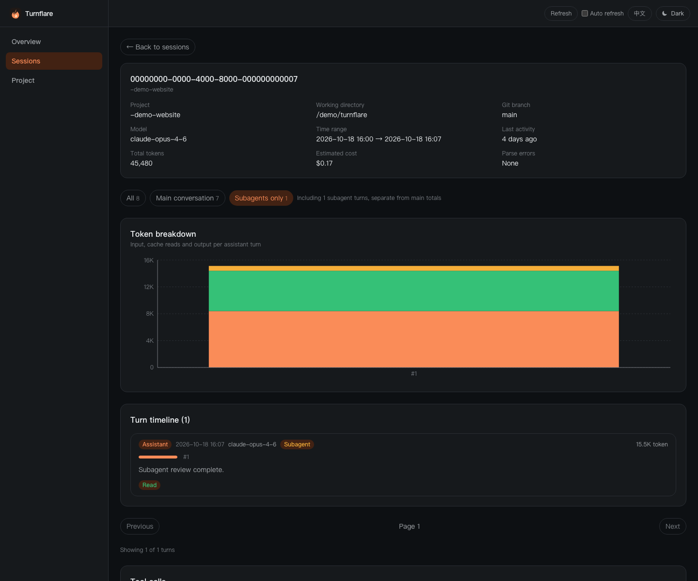

# Turnflare 🔥

**看清 Claude Code 的 token 花在哪里：从项目、会话，深入到每一轮对话和 subagent。**

[English](README.md) · [架构](docs/ARCHITECTURE.md) · [API](docs/API.md) · [路线图](docs/ROADMAP.md) · [参与贡献](CONTRIBUTING.md)

直接读取本地 Claude Code 会话记录，提供交互仪表盘、终端报表和可导出的分析报告。
适合比较项目用量、排查高成本会话、查看工具调用，以及区分主对话与 subagent 活动。

**本地分析，无需 API key，没有遥测。** 使用内置价目表，运行时不上传会话。
安装依赖时需要访问包管理器。



## v0.2.1 新增

新增**分析**页：日期快捷范围与自定义 UTC 区间、项目和模型筛选、主对话 / subagent / 合并统计、
活动热图、日 / 周 / 月明细、模型及工具排行和本机自设预算。图表与导出使用同一份筛选数据。
支持 HTML、CSV、Markdown、JSON 下载，桌面版通过系统保存窗口导出。

会话页支持 ID、路径、分支和消息预览搜索（每条消息前 200 字）。预算与成本均为 API 等价估算，
不是订阅账单或官方剩余额度。



## 桌面应用：下载即可使用

**[下载 Windows / macOS 应用](https://github.com/Naloam/turnflare/releases/tag/v0.2.1)**

| 系统 | 下载 |
| --- | --- |
| Windows x64 | [安装版](https://github.com/Naloam/turnflare/releases/download/v0.2.1/Turnflare-0.2.1-windows-x64-setup.exe) · [免安装版](https://github.com/Naloam/turnflare/releases/download/v0.2.1/Turnflare-0.2.1-windows-x64-portable.exe) |
| Mac，Apple 芯片 | [DMG](https://github.com/Naloam/turnflare/releases/download/v0.2.1/Turnflare-0.2.1-mac-arm64.dmg) |
| Mac，Intel 芯片 | [DMG](https://github.com/Naloam/turnflare/releases/download/v0.2.1/Turnflare-0.2.1-mac-x64.dmg) |

打开应用即可自动读取本地历史；**选择日志目录**可指定其他位置，**体验示例**可先查看生成的样例。无需安装 Node、pnpm 或输入命令。支持 Windows 10/11 x64 和 macOS 13+。

初版尚无受信任的开发者签名和 Apple 公证，首次打开可能需要在系统界面确认。详见 [安装说明与签名状态](docs/releases/0.2.1.md)。

## 快速体验

需要 **Node.js 22+**（推荐 22 或 24）。直接安装 GitHub 发布包：

```bash
npm install --global https://github.com/Naloam/turnflare/releases/download/v0.2.1/turnflare-0.2.1.tgz
turnflare demo
```

打开 **http://127.0.0.1:8787**。示例包含 3 个项目、9 场会话、subagent 和无价目模型。
数据库在内存，禁止写请求，**不读取你的真实历史**。Ctrl+C 退出。
界面支持中英文切换并保存选择；命令行帮助也支持两种语言，文本报表目前保留中文。

## 分析自己的数据

```bash
turnflare start
```

扫描 `~/.claude/projects`，在同一个地址提供仪表盘与 API，索引保存在
`~/.turnflare/turnflare.db`。默认每 10 秒增量扫描，界面每 10 秒刷新，无需反复重启。
`TURNFLARE_WATCH_INTERVAL_MS=0` 可关闭后台扫描，页面顶部也可以暂停自动刷新。

`TURNFLARE_DATA_ROOT` 指定日志目录，`TURNFLARE_DB` 指定索引。
服务默认只监听本机且没有身份认证，修改网络监听前请阅读 [隐私说明](SECURITY.md)。

从源码开发需要 pnpm 10：

```bash
git clone https://github.com/Naloam/turnflare.git
cd turnflare
pnpm install --frozen-lockfile
pnpm demo
pnpm start
```

目前通过 GitHub Release 分发，还没有 npm registry 发布；不要直接运行 `npx turnflare`。
安装包自带编译结果、仪表盘和迁移文件，不需要 pnpm 或 TypeScript。
SQLite 是原生依赖，平台没有预编译二进制时需要本地 C++ 编译工具链。

## 主要能力

| 问题                      | 对应功能                                     |
| ------------------------- | -------------------------------------------- |
| 哪个项目用量最高？        | 项目比较、模型分布、小时和天粒度趋势         |
| 一场会话到底发生了什么？  | 对话时间线、token 瀑布图、文本预览和工具调用 |
| subagent 贡献了多少活动？ | 单独汇总，以及主对话 / subagent 筛选         |
| 为什么成本为零？          | 明确标注无价目模型和估算结果                 |
| 能否导出？                | JSON、Markdown、CSV、独立 HTML 报告          |

支持大行 JSONL、写入中的截断行、消息去重、增量扫描和同一会话多文件合并。
链条筛选在数据库的 500 条详情限制之前执行，长主对话不会再挤掉 subagent。
每页最多显示 500 条，支持按链条翻页并显示当前条数与总条数。



## 命令行

```bash
pnpm cli scan
pnpm cli stats --days 30
pnpm cli sessions --limit 20 --sort cost
pnpm cli session <session-id>
pnpm cli report --format html --out report.html
pnpm cli models
pnpm cli serve --port 9000
```

脚本需要纯 JSON 时，直接使用构建入口，避开包管理器自身的提示：

```bash
node packages/cli/dist/bin.js stats --json > usage.json
```

## 成本口径

金额是**按本地日志和内置单价计算的 API 等价估算**，不代表订阅账单或实际扣费。
无价目模型计零并显示提示；部分阶梯价无法从汇总数据还原。详见 [计价说明](docs/PRICING.md)。

总览、项目/模型图表和会话总额默认只统计**主对话**；subagent 另列，不能把总览金额当成所有活动的总账单。

## 同类工具与定位

[ccusage](https://github.com/ccusage/ccusage) 擅长多种 coding agent 的终端报表；
[Claude Code Usage Monitor](https://github.com/Maciek-roboblog/Claude-Code-Usage-Monitor) 聚焦实时额度和预测；
[claude-dashboard](https://github.com/uppinote20/claude-dashboard) 把信息放进状态栏。

Turnflare 聚焦会话历史、逐轮排查、subagent 分析和本地报告导出。
目前仅支持 Claude Code，没有订阅额度监控，通过 GitHub Release 分发。
完整对照和改进优先级见 [竞品研究](docs/COMPETITIVE_ANALYSIS.md)。

## 开发与贡献

```bash
pnpm check
pnpm --filter @turnflare/web exec playwright install chromium
pnpm test:e2e
pnpm bench
```

类型契约统一放在 `packages/contracts`；解析与计价在 `core`；SQLite、扫描、报告与 HTTP 在 `api`；
`cli` 只使用后端公开入口；`web` 只从工作区包导入类型。开发热更新可在构建后分别运行 `pnpm api` 和 `pnpm web`。

欢迎中英文反馈和贡献。如果它帮你看清了用量，欢迎点一个 star，帮助更多人发现项目。

[MIT](LICENSE) · 非 Anthropic 官方项目。
