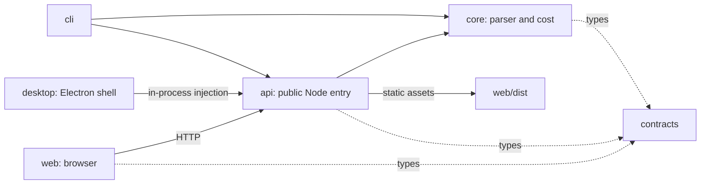

# Turnflare 架构规格书

> 版本：0.2.1 · 更新：2026-10-22
> 本文件是所有实现工作的唯一权威规格。实现前必读。

## 1. 项目定位

Turnflare 是一个**本地优先**的 Claude Code 会话分析平台。它直接解析 `~/.claude/projects/**/*.jsonl`
会话记录，提取 token 用量、成本、模型分布、缓存命中率、工具调用统计，并通过 API / Web / CLI 三种形态呈现。

### 1.1 数据源格式（已实地验证）

会话 jsonl 每行一个 JSON 对象，关键形态：

| `type`                                                    | 关键字段                                                                                                          | 说明                           |
| --------------------------------------------------------- | ----------------------------------------------------------------------------------------------------------------- | ------------------------------ |
| `user`                                                    | `message.role`, `message.content`, `uuid`, `parentUuid`, `timestamp`, `cwd`, `gitBranch`, `sessionId`, `version`  | 用户消息                       |
| `assistant`                                               | `message.model`, `message.content[]`, `message.usage`, `message.stop_reason`, `uuid`, `parentUuid`, `isSidechain` | 助手消息，**token 用量在这里** |
| `api-request`                                             | `params.model`, `params.max_tokens`, `params.thinking`, `params.output_config.effort`, `betas`                    | 请求参数快照                   |
| `api-request-blob`                                        | `hash`, `message`                                                                                                 | 请求体内容寻址存储             |
| `attachment`                                              | `attachment`                                                                                                      | 附件（图片 / 文件）            |
| `file-history-snapshot`                                   | `snapshot`                                                                                                        | 文件快照                       |
| `mode` / `permission-mode` / `last-prompt` / `atis-latch` | —                                                                                                                 | 会话级元数据                   |

`message.usage` 真实结构（字段必须全部支持，缺失时补 0）：

```json
{
  "input_tokens": 40198,
  "cache_creation_input_tokens": 0,
  "cache_read_input_tokens": 0,
  "output_tokens": 1183,
  "output_tokens_details": { "thinking_tokens": 0 },
  "server_tool_use": { "web_search_requests": 0, "web_fetch_requests": 0 },
  "cache_creation": {
    "ephemeral_1h_input_tokens": 0,
    "ephemeral_5m_input_tokens": 0
  },
  "service_tier": "standard",
  "speed": "standard"
}
```

`message.content` 是 block 数组，block 类型：`text`、`thinking`、`tool_use`（含 `name`/`id`/`input`）、
`tool_result`（在 user 消息里，含 `tool_use_id`/`content`/`is_error`）。

### 1.2 已知坑（实现必须处理）

1. **超大行**：单个 jsonl 行可达数 MB（system prompt + 全量规则）。禁止 `readFileSync().split('\n')`
   一次性载入 14MB 文件后全部持有 —— 必须流式逐行处理。
2. **截断行**：会话正在写入时读取会出现半行 JSON。必须捕获 `JSON.parse` 异常并记入 `parseErrors`，
   绝不让整个文件解析失败。
3. **`tool_result` 体积**：`content` 可能是字符串或 block 数组，需归一化为字符数。
4. **时区**：timestamp 是 UTC ISO 串（`2026-10-19T08:25:26.923Z`）。分桶统计必须支持本地时区偏移。
5. **重复 uuid**：同一消息可能因 compaction 出现在多条记录中，聚合时按 `uuid` 去重（保留首次）。
6. **侧链**：subagent 的记录 `isSidechain: true`，统计时需可区分。

## 2. Monorepo 结构

```
turnflare/
├── packages/
│   ├── contracts/ @turnflare/contracts  共享领域与 HTTP 类型（仅声明）
│   ├── core/     @turnflare/core  解析 + 统计 + 成本引擎（零依赖，纯 Node）
│   ├── api/      @turnflare/api   Fastify REST 服务 + SQLite 持久化
│   ├── web/      @turnflare/web   React 19 + Vite 仪表盘
│   ├── cli/      @turnflare/cli   命令行工具
│   └── desktop/  @turnflare/desktop  Windows / macOS 原生窗口与打包入口
├── docs/
├── tools/        构建辅助脚本
└── .github/workflows/
```

### 2.1 模块依赖与公开接口



`packages/contracts/src/domain.ts` 与 `http.ts` 是类型唯一真源。core 的 `types.ts`、
api 的 `types.ts` 和 web 的 `types/api.ts` 是兼容导出入口，不复制声明。
core 没有第三方运行时代码依赖；contracts 只生成类型声明。web 不导入 Node 运行时模块。

CLI 使用 `@turnflare/api` 公开入口获取配置、数据库、仓储、Scanner、报告与服务构建能力，
不能导入它的 `dist` 或 `src` 私有文件。`pnpm contracts` 校验声明身份和包导入规则，
消费方的 strict typecheck 校验类型实际使用。详见 [ADR 0001](adr/0001-shared-contracts-and-public-entry.md)。

### 2.2 启动与数据隔离

- `pnpm start`：按 workspace 顺序构建 → 扫描本地日志 → 在 8787 同时提供仪表盘与 API。
- `pnpm demo`：构建 → 生成临时示例 → 内存数据库 → 同地址展示，拒绝写请求。
- E2E 使用同一示例生成器和构建后的界面，独立端口，不读取真实历史，不复用已有服务。
- `start()` 管理的数据库在 app 关闭时释放；信号监听器随同移除。

## 3. 包规格

### 3.1 @turnflare/core

公开入口为 `packages/core/src/index.ts`，实际签名以导出的 TypeScript 声明为准。

| 模块 | 主要入口 | 职责 |
| --- | --- | --- |
| parser | `scanProjects`、`parseSessionFile`、`streamSessionRecords` | 文件发现、流式解析和记录归一化 |
| stats | `aggregate`、`bucketByHour`、`bucketByDay`、`aggregateTools` | 主对话/侧链统计、时间桶与工具汇总 |
| cost | `priceFor`、`costOf`、`costOfWithSplit` | 模型查价、速度档位与缓存 TTL 计价 |
| format | `formatTokens`、`formatCost`、`formatDuration`、`relativeTime` | 展示格式化 |

成本计算接收对象：`costOf({ usage, model, speed? })`，而非位置参数。
`priceFor(model)` 返回包含可空 `pricing` 的查询结果；未知模型不会猜价。
`scanProjects(root)` 返回附带非致命 `errors` 的只读数组。

约束：

- **无第三方运行时代码依赖**（运行时只用 `node:` 内置模块；类型依赖 contracts）。格式化工具函数必须纯函数、可 tree-shake。
- 所有文件 ≤ 400 行；单函数 ≤ 50 行；嵌套 ≤ 4 层。
- 不可变：禁止对入参对象赋值，一律返回新对象。
- 覆盖率 ≥ 85%（行 + 分支），由 `packages/core/vitest.config.ts` 的全局阈值把关。
  这里曾经写着"核心解析与成本函数必须 100% 分支覆盖"，但实测没有任何机制在强制它——
  只有那一个 85% 的全局阈值。当前 `parser/discover.ts` 分支覆盖率 86.36%，
  已是最低的一个；`cost/` 与 `stats/` 的实际分支覆盖率都在 97% 以上。
  真要给核心解析立 100% 的门槛，得先决定由谁执行（per-file 阈值？CI 单独一条命令？），
  在那之前把它写成目标是误导。
- 测试用 vitest，测试文件与源文件同目录 `*.test.ts`。

### 3.2 @turnflare/api

- Fastify 5 + `@fastify/cors` + `@fastify/static` + `better-sqlite3`。
- 统一响应包络（见全局 patterns 规则）：

```typescript
interface ApiResponse<T> {
  success: boolean
  data: T | null
  error: string | null
  meta?: { total: number; page: number; limit: number; generatedAt: string }
}
```

- 路由表：

| 方法 | 路径                                           | 说明                                  |
| ---- | ---------------------------------------------- | ------------------------------------- |
| GET  | `/api/health`                                  | 健康检查，返回版本与数据根目录        |
| GET  | `/api/sessions`                                | 会话列表（分页、按项目过滤）          |
| GET  | `/api/sessions/:id`                            | 单会话详情（chain 筛选，每页 500 条） |
| GET  | `/api/stats/overview`                          | 聚合总览                              |
| GET  | `/api/stats/models`                            | 按模型分布                            |
| GET  | `/api/stats/timeline`                          | 时间线（`?granularity=hour\|day`）    |
| GET  | `/api/stats/tools`                             | 工具调用统计                          |
| GET  | `/api/stats/projects`                          | 按项目分布                            |
| POST | `/api/scan`                                    | 触发一次全量扫描，返回任务句柄        |
| GET  | `/api/scan/:jobId`                             | 查询扫描任务进度                      |
| GET  | `/api/report?format=json\|markdown\|csv\|html` | 导出报告                              |

- SQLite schema：迁移脚本位于 `packages/api/src/db/migrations/`，由
  `schema_migrations.version` 做版本化管理（只增不改，改结构必须新增 `NNN_*.sql`）。
  现存表包含 `sessions` / `turns` / `tool_invocations` / `scanned_files` /
  `scan_jobs` / `schema_migrations` 与索引。扫描任务状态由进程内任务表管理。001 里还建过一张 `daily_rollup`（原意是天粒度
  预聚合），但从未有任何语句读写它，已由迁移 003 删除——时间线是每次查询从
  `turns` 现算的，不走预聚合表。
- 扫描必须是**增量**的：以 `filePath + mtimeMs + size` 为键，未变化的文件跳过。
- 错误处理：全局 error handler，`error` 字段给人可读信息，服务端 `log` 记录详情。
  绝不在响应里泄漏绝对路径栈信息。
- 端口从 `PORT` 环境变量读，默认 8787；默认监听 `127.0.0.1`。
- 构建后的 `web/dist` 存在时一并提供静态文件；未知 API 路径仍返回 JSON 404。
- 会话详情支持 `?chain=all|main|side&page=1`，先筛选后分页；全量链条计数不受分页影响。

### 3.3 @turnflare/web

- React 19 + TypeScript + Vite 8 + Tailwind CSS v4 + Recharts。
- 页面：
  1. **总览 Dashboard** — KPI 卡片（总 token / 总成本 / 会话数 / 缓存命中率）+ 成本趋势面积图 + 模型占比饼图
  2. **会话列表** — 表格，支持按项目/模型/时间过滤、排序、分页
  3. **会话详情** — 单会话 turn 时间线 + token 瀑布图 + 工具调用明细
  4. **项目对比** — 横向柱状图
- 组件规范：函数组件 + 命名 `interface XxxProps`；不用 `React.FC`；自定义 hook 用 `use` 前缀。
  组件文件 ≤ 200 行，超过必须拆分。
- 数据层：`useApi` hook（fetch + AbortController + 加载/错误态），禁止在组件里直接 fetch。
- 深浅色主题通过 Tailwind `dark:` 变体，遵循系统偏好。
- 无 `console.log`；错误用统一 `<ErrorBoundary>`。界面支持英中文，详细 API 诊断目前为中文。

### 3.4 @turnflare/cli

- 安装包提供 `turnflare demo`（隔离示例）与 `turnflare start`（扫描、服务与实时更新）。
- 报表命令使用自研 argv 解析：
  - `turnflare scan [--root DIR] [--project SLUG] [--since DATE]` — 扫描并落库
  - `turnflare stats [--format table|markdown] [--days N] [--json]` — 终端统计报表
  - `turnflare sessions [--limit N] [--project SLUG]` — 会话列表
  - `turnflare session <id>` — 单会话详情
  - `turnflare report --format html --out FILE` — 生成 HTML 报告
  - `turnflare models` — 模型单价表
  - `turnflare serve [--port N]` — 启动 API + Web
- 输出：表格用 `cli-table3`，颜色用 `picocolors`，进度条用 `cli-progress`。
- 所有命令支持 `--json` 输出机器可读结果。
- 退出码：0 成功，1 运行时错误，2 参数错误。

## 4. 全局工程规范（所有包通用）

1. **TypeScript strict** + `noUncheckedIndexedAccess` + `exactOptionalPropertyTypes`。
2. **不可变数据**：禁止 `arr.push` 修改入参、禁止对象字段赋值；用展开 / `map` / `filter` / `toSorted`。
3. **错误处理**：`unknown` 捕获后窄化；对外抛中文可读错误；服务端记录完整上下文。
4. **输入校验**：API 边界用 zod schema 校验；CLI 参数在 `argv.ts` 一处统一校验
   （command-specs.ts 的声明同时服务解析、帮助文本与参数校验，避免三处漂移）。
5. **命名**：`camelCase` 变量函数、`PascalCase` 类型组件、`UPPER_SNAKE_CASE` 常量、`is/has/should/can` 布尔前缀。
6. **禁止**：`any`、`as` 强制断言（测试中可用 shoehorn）、`@ts-ignore`、`console.log`、魔法数字。
7. **注释**：解释"为什么"而非"做什么"；公开 API 必须 JSDoc。
8. **TDD**：先写失败测试，再实现。
9. **文件规模**：源文件 200-400 行，硬上限 800 行；不要为满足下限填充文件。
10. **Git**：conventional commits，中文描述正文。

## 5. 交付里程碑

- **M1 基础**：core 解析 + 统计 + 成本，覆盖率 ≥ 85%，`pnpm test` 全绿。
- **M2 服务**：api 全路由 + SQLite 增量扫描 + 集成测试。
- **M3 界面**：web 四页面 + 响应式 + 深浅色。
- **M4 终端**：cli 七命令 + 人类/机器双格式输出。
- **M5 交付**：README、架构图、CI（typecheck + test + build）、E2E（Playwright）。
